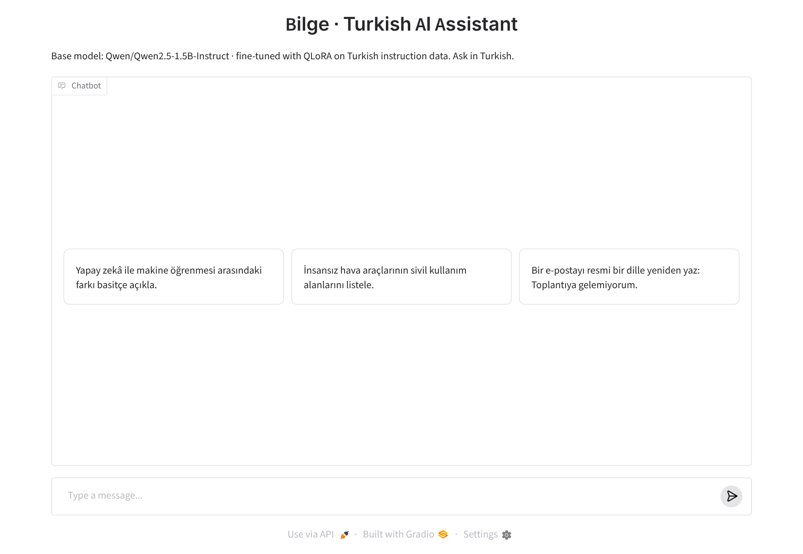
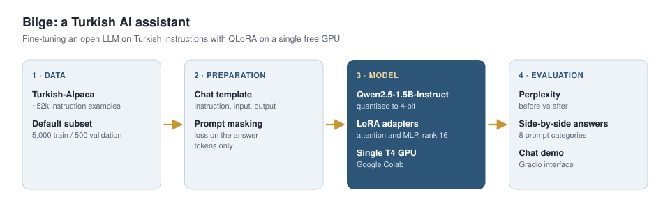

# Bilge · Turkish AI Assistant

**Bilge** is my own Turkish-speaking AI assistant, which I am building by fine-tuning an open-source large language model on Turkish instruction data with **QLoRA**. The project covers training, a **measurable comparison** against the base model and a browser-based **chat interface**.

```bash
# Chat with Bilge after training:
python app.py --adapter runs/bilge-1.5b-lora/adapter --share
```

<p align="center"></p>
<p align="center"><sub>Bilge's chat interface (Gradio).</sub></p>

> **Status:** Work in progress. Result tables will be added as experiments are completed.

## Problem

Multilingual open models often answer Turkish instructions with short, incomplete or grammatically weak responses, while full fine-tuning requires a lot of GPU memory. This project aims to improve Turkish instruction-following on a single free Colab GPU (T4, 16 GB) by training only a small fraction of the model's parameters.

## Approach

<p align="center"></p>

| Step | Method | File |
|---|---|---|
| 1. Data preparation | Convert instruction / input / output examples to the model's chat template; mask the prompt so the loss is computed on the answer only | `src/train_lora.py` |
| 2. QLoRA training | Quantize the base model to 4-bit; attach LoRA adapters to the attention and MLP layers | `src/train_lora.py` |
| 3. Quantitative evaluation | Perplexity before and after training on a held-out validation set | `src/train_lora.py` |
| 4. Qualitative evaluation | Side-by-side answers of the base and fine-tuned model on fixed prompts in 8 categories | `src/compare_outputs.py` |
| 5. Demo | Bilge's Gradio chat interface | `app.py` |


## Model and data

- **Base model:** [Qwen2.5-1.5B-Instruct](https://huggingface.co/Qwen/Qwen2.5-1.5B-Instruct) (Apache-2.0)
- **Data:** [TFLai/Turkish-Alpaca](https://huggingface.co/datasets/TFLai/Turkish-Alpaca) (~52k Turkish instruction examples, Apache-2.0)
- **Default settings:** 5,000 training examples, 500 validation examples, 1 epoch, LoRA rank 16, up to 512 tokens

Other models or datasets can be used via `--model` and `--dataset`. The dataset must have `instruction`, `input` and `output` columns.

## Installation

```bash
git clone https://github.com/mahdildarr/bilge.git
cd bilge
pip install -r requirements.txt
```

The quickest way to run everything is the `notebooks/colab_qlora_training.ipynb` notebook on Google Colab (T4 GPU).

## Usage

```bash
# 1) QLoRA training (perplexity before / after is measured automatically)
python src/train_lora.py --train-samples 5000 --eval-samples 500 --epochs 1

# 2) Base model vs. fine-tuned model
python src/compare_outputs.py --adapter runs/bilge-1.5b-lora/adapter

# 3) Chat interface
python app.py --adapter runs/bilge-1.5b-lora/adapter --share
```

## Evaluation metrics

- **Perplexity:** On a held-out validation set, computed over answer tokens only; lower is better
- **Qualitative comparison:** Answers to the same prompts in explanation, technical knowledge, summarization, writing, reasoning, classification, code and grammar categories (`prompts/evaluation_prompts.json`)
- **Efficiency:** Share of trainable parameters and training time

## Results

| Model | Validation loss | Perplexity | Trainable parameters |
|---|---|---|---|
| Qwen2.5-1.5B-Instruct (base) | _TBD_ | _TBD_ | – |
| **Bilge** (+ Turkish QLoRA fine-tuning) | _TBD_ | _TBD_ | _TBD_ |

## Roadmap

- [x] Training, evaluation and demo pipeline
- [ ] Baseline experiment with 5,000 examples
- [ ] Effect of training set size and LoRA rank
- [ ] Publish the adapter on the Hugging Face Hub

## Project structure

```
├── app.py                         # Gradio chat interface
├── notebooks/colab_qlora_training.ipynb
├── prompts/evaluation_prompts.json  # qualitative evaluation prompts (Turkish)
├── src/
│   ├── common.py                  # model loading, prompt format, generation
│   ├── train_lora.py              # QLoRA training and perplexity
│   └── compare_outputs.py         # base ↔ fine-tuned comparison
└── requirements.txt
```

## References

- Hu et al., *LoRA: Low-Rank Adaptation of Large Language Models*, ICLR 2022
- Dettmers et al., *QLoRA: Efficient Finetuning of Quantized LLMs*, NeurIPS 2023
- [Hugging Face Transformers](https://github.com/huggingface/transformers) · [PEFT](https://github.com/huggingface/peft)

## License

MIT
